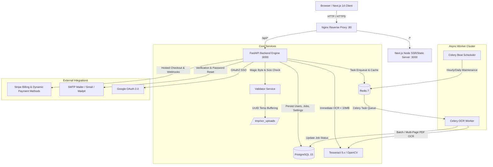

# System Architecture: ScanText OCR SaaS Monorepo

## 1. High-Level Architecture Overview

The **ocr-saas** platform is a full-featured Optical Character Recognition SaaS application engineered with a distributed, microservices-based architecture supporting synchronous and asynchronous OCR workflows, JWT authentication, tiered quota enforcement, Stripe subscription billing, and dynamic administrative control.



---

## 2. Directory Structure

```
ocr-saas/
├── docs/
│   ├── architecture.md           # System architecture, workflows, & design decisions
│   ├── api-specification.md      # OpenAPI / REST API detail specs & runbooks
│   ├── security-deployment.md    # Security model, zero-plaintext secrets, & deployment
│   └── test-verification-report.md # Comprehensive test execution report
├── frontend/                     # Next.js 14 TypeScript Web App
│   ├── src/app/                  # App Router pages (/pricing, /dashboard, /admin, etc.)
│   ├── src/components/           # UI Components (Dropzone, Controls, QuotaExceededModal)
│   ├── src/services/             # Axios API client wrapper
│   └── Dockerfile
├── backend/                      # Python FastAPI Application
│   ├── app/
│   │   ├── api/                  # Auth, OCR, Jobs, Billing, Stripe Webhooks, Admin
│   │   ├── core/                 # App configuration & JWT security utilities
│   │   ├── db/                   # SQLAlchemy models, Alembic migrations, database session
│   │   ├── services/             # Validation service, OCR engine, email delivery
│   │   └── worker/               # Celery app, background OCR worker tasks, beat schedules
│   ├── tests/                    # pytest suite (43 automated tests)
│   ├── requirements.txt
│   └── Dockerfile
├── infrastructure/               # Container & Reverse Proxy Orchestration
│   ├── nginx/default.conf        # Nginx routing & body limit configuration
│   ├── .env.example              # Environment configuration template
│   └── docker-compose.yml        # Orchestration for all 8 microservices
└── README.md                     # Comprehensive Setup & Quickstart Guide
```

---

## 3. Technology Stack & Key Decisions

| Tier | Technology | Purpose | Key Rationale |
| :--- | :--- | :--- | :--- |
| **Frontend** | Next.js 14+, TypeScript, Tailwind CSS | UI Client Application | Fast SSR and static optimization, responsive dark mode design system |
| **Backend Framework**| Python 3.11+, FastAPI, Pydantic v2 | Async API Server | High-performance asynchronous API, auto-generated OpenAPI documentation |
| **Database** | PostgreSQL 15 | Relational Storage | Transactional guarantees for users, subscriptions, quotas, and audit logs |
| **Message Broker** | Redis 7 | Distributed Queue & Cache | Sub-millisecond queue dispatching for Celery async OCR jobs and rate limiting |
| **Background Workers**| Celery 5.3+ & Celery Beat | Task Processing & Cron | Offloads multi-page PDF processing and periodic cleanup from web threads |
| **OCR Engine** | PyTesseract (Tesseract 5.x) | Character Extraction | Battle-tested, accurate open-source OCR supporting multi-language datasets |
| **Image & PDF Engine**| OpenCV, Pillow, `pdf2image` | Pre-processing | Grayscale conversion, thresholding, noise reduction, and PDF rasterization |
| **Billing Integration**| Stripe API (v16.0+) | Pro Tier Subscriptions | Dynamic Payment Methods (Cards, Apple Pay, Google Pay) with idempotent webhooks |
| **Email Delivery** | Python `smtplib` / Mailpit / Gmail | Transactional Mail | Secure TLS/SSL SMTP with Google App Password support and live diagnostic probe |
| **Reverse Proxy** | Nginx Alpine | Gateway & Security | TLS termination, gzip compression, rate limiting, and 50MB payload limits |

---

## 4. Security & Temporary File Lifecycle

1. **Binary Magic Byte Inspection**: Incoming byte streams are validated against known binary signatures (`JPEG`, `PNG`, `WEBP`, `PDF`) to prevent executable file execution attacks.
2. **Path Obfuscation & UUID Isolation**: Files are assigned a random `uuid4()` name in `/tmp/ocr_uploads/`. Original user filenames are never written to disk.
3. **Automated Destruction**: Python `try...finally` context managers and background cleanup routines guarantee immediate file deletion after OCR text extraction completes.
4. **Secret Protection**: Stripe keys, Google OAuth secrets, and SMTP passwords are never exposed in plaintext in the Admin Console. Submitting masked values (`••••`) preserves existing secrets untouched.
5. **HMAC Webhook Verification**: Stripe webhooks require valid `stripe-signature` verification with timestamp tolerance checks and database idempotency deduplication.

---

## 5. Stripe Dynamic Payment Methods & Product Configuration

* **Dynamic Payment Methods**: The backend omits `payment_method_types`, allowing Stripe to automatically present all payment methods enabled in the [Stripe Dashboard](https://dashboard.stripe.com/settings/payment_methods).
* **Self-Serve Pro Plan**: $19.00/month recurring plan configured via Stripe Products (`price_1Q...`).
* **Live Configuration**: Stored in PostgreSQL `SystemSetting` table and modifiable in real-time from `/admin`.

---

## 6. Email Mailer Infrastructure & Diagnostics

* **Local Development**: Mailpit catcher captures all registration and password reset links without contacting external networks (`http://localhost:8025`).
* **Production Gmail**: Integrates via port 587 (`STARTTLS`) or 465 (`SSL`) using 16-character Google App Passwords.
* **Live Admin Probe**: Direct diagnostic endpoint (`POST /api/v1/admin/smtp/test-connection`) verifies SMTP server connectivity and TLS handshakes on demand.
